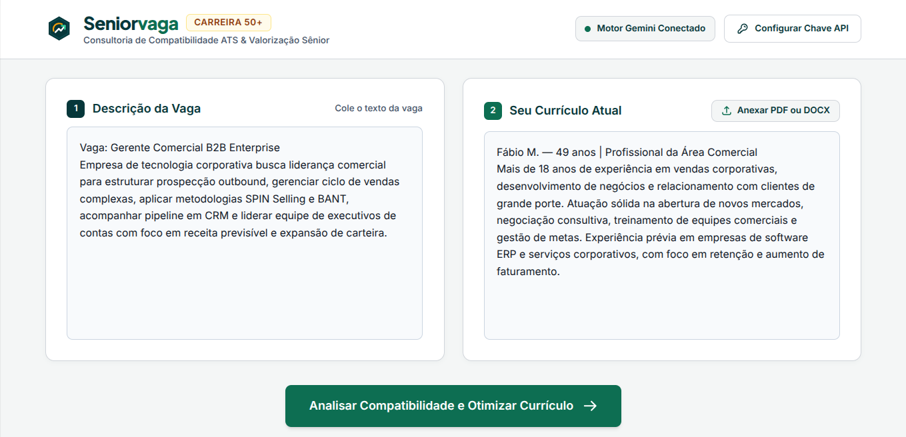
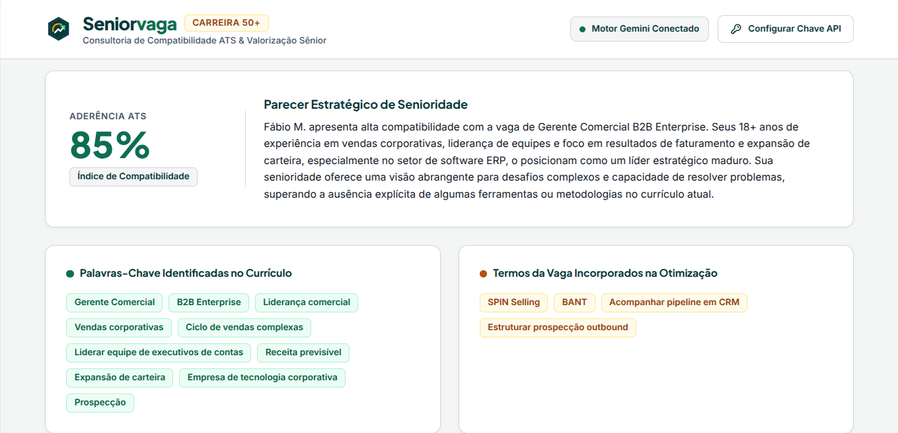
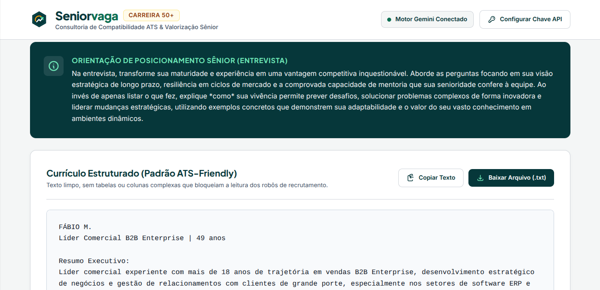

# Seniorvaga — Inteligência Executiva & Otimização ATS Anti-Etarismo

Plataforma web de análise e reestruturação de currículos orientada a sistemas **ATS (Applicant Tracking Systems)**, desenvolvida para combater o etarismo corporativo e traduzir a experiência de profissionais **45+ e 50+** em ativos estratégicos reconhecidos pelos filtros de recrutamento.

---

## Demonstração Online

* **Aplicação em Produção (GitHub Pages):** [https://fabiocabmed.github.io/seniorvaga/](https://fabiocabmed.github.io/seniorvaga/)

> *Nota: Para testar imediatamente sem precisar preencher dados manualmente, utilize os botões de **Demonstração Prática com Perfis Sênior** disponíveis na aplicação.*

### Jornada Completa da Interface

| 1. Apresentação Editorial (Hero 50+) | 2. Entrada de Vaga e Currículo (PDF/DOCX) |
| :---: | :---: |
|  |  |

| 3. Diagnóstico ATS & Palavras-Chave | 4. Mentoria de Entrevista & Currículo Final |
| :---: | :---: |
|  |  |

---

## O Problema e a Solução

Profissionais maduros acumulam décadas de repertório, liderança e capacidade de resolução de crises, mas frequentemente são descartados na triagem inicial por algoritmos que buscam correspondências literais de termos técnicos atuais ou falham na leitura de layouts complexos.

O **Seniorvaga** atua como um consultor de carreira digital que cruza os requisitos reais da vaga com o histórico do candidato, entregando:

1. **Índice de Aderência ATS:** Percentual objetivo de compatibilidade entre o currículo atual e a vaga desejada.
2. **Parecer Estratégico de Senioridade:** Diagnóstico claro sobre como a experiência acumulada responde aos desafios da posição.
3. **Mapeamento de Palavras-Chave:** Separação visual entre os termos já presentes no perfil e as competências da vaga incorporadas na otimização.
4. **Orientação de Posicionamento Sênior:** Recomendação prática para neutralizar vieses etários durante a entrevista.
5. **Currículo Estruturado (ATS-Friendly):** Reescrita limpa, pronta para leitura por robôs de recrutamento, com opção de cópia rápida ou download em `.txt`.

---

## Diferenciais Técnicos e Éticos

* **Leitura Local de Arquivos (`PDF`, `DOCX` e `TXT`):** Extração de texto executada diretamente no navegador via `PDF.js` e `Mammoth.js`. Nenhum documento é enviado ou armazenado em servidores externos.
* **Compromisso Anti-Alucinação:** A engenharia de prompt impõe restrições rigorosas para que a Inteligência Artificial reorganize e valorize a narrativa sem nunca inventar cargos, empresas, diplomas ou experiências inexistentes.
* **Privacidade de Credenciais (BYOK):** Arquitetura *client-side* onde o usuário insere sua própria chave do Google AI Studio, armazenada exclusivamente no `localStorage` do navegador, garantindo zero exposição de chaves no repositório.

---

## Design System & Evolução do Projeto

Durante o desenvolvimento, o projeto passou por um processo iterativo de refinamento técnico e de experiência do usuário (UX):

| Etapa | Foco da Iteração | Decisão de Engenharia e Design |
| :--- | :--- | :--- |
| **1. Arquitetura Base** | Estruturação do motor de análise e resposta JSON | Criação da integração direta com a API `gemini-2.5-flash` retornando score, parecer, palavras-chave e currículo reescrito. |
| **2. Design System AAA** | Substituição de tema escuro genérico por padrão institucional | Adoção de paleta de alto contraste (**Platinum** `#F4F6F6`, **Midnight Green** `#06373A` e **Executive Emerald** `#0D6E52`) inspirada em diretrizes de acessibilidade e legibilidade para o público 50+. |
| **3. Redução de Atrito** | Facilidade de entrada de dados pelo candidato | Implementação de parser local para upload direto de currículos em `.pdf` e `.docx`, somado à exportação limpa em `.txt`. |
| **4. Identidade & Hero** | Humanização e alinhamento editorial | Criação do selo vetorial hexagonal **Seniorvaga** e composição assimétrica alinhada topo-a-base com foco na valorização da maturidade profissional. |

---

## Stack Tecnológica

* **Frontend:** HTML5 Semântico, Tailwind CSS, JavaScript Vanilla (ES6+)
* **Tipografia:** Plus Jakarta Sans (Títulos) e Inter (Leitura)
* **Inteligência Artificial:** Google Gemini API (`gemini-2.5-flash`)
* **Processamento de Documentos:** Mozilla `PDF.js` e `Mammoth.js`

---

## Como Executar

1. Acesse o link da aplicação hospedada no GitHub Pages (ou abra o arquivo `index.html` em qualquer navegador moderno).
2. Clique em **Configurar Chave API** no canto superior direito e insira sua chave gratuita gerada no [Google AI Studio](https://aistudio.google.com/).
3. Cole a descrição da vaga no **Passo 1**.
4. Anexe seu currículo em **PDF/DOCX** ou cole o texto no **Passo 2** e clique em **Analisar Compatibilidade e Otimizar Currículo**.

---

## Autor

Desenvolvido por **Fábio Cabral Medeiros** — Especialista Comercial B2B e Fundador da **Vitally Studio**.  
Projeto construído como entrega prática de conclusão da formação em Inteligência Artificial e Vibe Coding na **Digital Innovation One (DIO)**.
